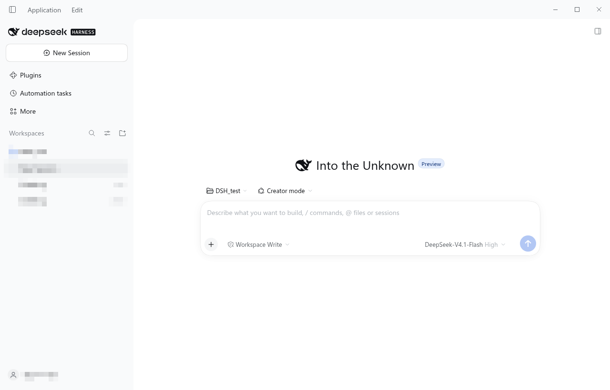

# DeepSeek Harness · Termux 桌面壳

用 Electron 复刻 DeepSeek Harness 官方桌面端的窗口外壳，跑在 **Termux 原生环境（Android / Bionic libc）** 上，使用 Termux 仓库里 NDK 编译的 `electron43`，不需要 proot、不需要 glibc 兼容层。

窗口里的应用区不是仿写：外壳启动 `dsh web`，把官方 Web GUI 的入口 URL 装进窗口，再补上官方桌面端的窗口契约（40px 标题栏、`data-windows-titlebar`、Application/Edit 菜单、三键控件）。所以应用区是**同一份 bundle**，像素级一致；只有窗口边框这一圈是本仓库实现的。



```
┌───────────────────────────────────────────────────────────┐
│ ☰  应用 编辑                                 ─   □   ✕     │ ← 本仓库：caption
├───────────────────────────────────────────────────────────┤
│                                                           │
│   DeepSeek Harness Web GUI（官方 apps/web + client 插件）  │ ← 官方 bundle，未改动
│                                                           │
└───────────────────────────────────────────────────────────┘
```

## 目录

| 路径 | 作用 |
| --- | --- |
| `app/main.mjs` | 主进程：拉起 `dsh web`、建窗口、按官方 `createWindow` 参数开窗、IPC、原生菜单 |
| `app/preload.cjs` | 预加载：打标题栏标记、自绘三键与 Application/Edit 菜单、暴露文件桥 |
| `app/backend.mjs` | 后端管理：`dsh web --host 127.0.0.1 --port 0 --no-open`，从输出里取入口 URL，退出时回收 |
| `app/menus.mjs` | 原生弹出菜单模板（Application / Edit / 右键菜单） |
| `app/locale.mjs` | 官方 `apps/desktop/src/locale.ts` 的 8 种语言词表，原样转出 |
| `bin/dsh-app` | Termux 启动器：定位 Electron、按需起 Termux:X11、传 `--no-sandbox` |
| `termux/install.sh` | 一键安装：x11-repo、electron43、termux-x11、`@deepseek-ai/dsh`、部署外壳 |
| `tools/run.mjs` | 本机开发启动器（Electron 装在 `dev/`，避免遮蔽 Electron 内置模块） |
| `tools/preview.mjs` | 无头 Chromium 预览：注入与 preload 相同的标题栏 DOM，用于出图和布局回归 |
| `upstream/` | DSH 源码稀疏克隆，仅作对照参考，部署时可删 |

## Termux 安装

```bash
pkg install git nodejs
git clone <本仓库> ~/dsh-electron-termux
cd ~/dsh-electron-termux
bash termux/install.sh
```

`install.sh` 会执行：

```bash
pkg install x11-repo
pkg install electron43 termux-x11-nightly
npm install -g @deepseek-ai/dsh@latest
```

另外需要手动装一次 [Termux:X11 的 APK](https://github.com/termux/termux-x11/releases/tag/nightly)（`termux-x11-universal-debug.apk`），它是显示服务器，和 Termux 里的 `termux-x11-nightly` 配套。

## 运行

```bash
dsh-app
```

启动器按顺序做三件事：

1. 找 Electron：`$DSH_APP_ELECTRON` → `$PREFIX/lib/electron43/electron` → `$PREFIX/lib/electron/electron` → PATH 里的 `electron43` / `electron`。
2. 没有 `DISPLAY` 且装了 `termux-x11` 时，自动 `termux-x11 :0` 并等待 2 秒。
3. 以 `--no-sandbox` 启动 `app/`；主进程再拉起 `dsh web`，拿到带 token 的入口 URL 后开窗。

连接已经在跑的 Web UI：

```bash
dsh-app --url http://127.0.0.1:3080/?token=...
```

### 参数与环境变量

| 名称 | 作用 |
| --- | --- |
| `--url <url>` / `DSH_APP_URL` | 不自己起后端，直接加载这个 Web UI |
| `--devtools` | 开窗口时打开开发者工具 |
| `--screenshot <png>` | 加载完成后截图并退出（验证用） |
| `DSH_BIN` | 指定 `dsh` 可执行文件，默认走 PATH |
| `DSH_APP_ELECTRON` | 指定 Electron 可执行文件 |
| `--render=<mode>` / `DSH_APP_RENDER` | 合成模式：`auto`（默认，Termux 上用 `memory`）、`memory`、`software`、`gpu`、`swiftshader` |
| `DSH_APP_FLAGS` | 追加 Chromium 开关，如 `--force-device-scale-factor=1.25` |
| `DSH_APP_NO_X11=1` | 禁止启动器自动拉起 `termux-x11` |
| `DSH_APP_DISPLAY` | 指定 X display，默认 `:0` |

## 窗口契约

数值和标记都来自 `upstream/apps/desktop/src`，不是估的：

| 项 | 官方 desktop | 本仓库 |
| --- | --- | --- |
| 初始尺寸 | 1280×820 | 1280×820，超出屏幕时按 workArea 收缩 |
| 最小尺寸 | 520×600 | 520×600 |
| 标题栏 | `titleBarStyle: 'hidden'` + `titleBarOverlay`（Windows） | 无边框 + 自绘三键，40px |
| 标题栏高度 | `--dsh-windows-titlebar-height: 40px` | 同 |
| 文档标记 | `html[data-windows-titlebar]`（Windows） | 同 |
| caption 菜单 | `Application` / `Edit`，左边缘 `--dsh-windows-menu-start`（48/84px） | 同，样式逐条照抄官方 preload |
| 窗口控件 | 系统 overlay，46×40，右对齐，关闭悬停 `#e81123` | 自绘同尺寸同配色，颜色取 `body` 上的主题 token，最大化/还原图标联动 |
| 窗口控件配色 | `windowsAppearance` IPC 回传实测色 | 控件挂在 `<body>` 下直接继承 token（挂在 `<html>` 会丢失 `--dsw-*`，退化成灰） |
| 右键菜单 | 可编辑区出撤销/重做/剪切/复制/粘贴/全选 | 同，文案取自官方词表，加速键标签按官方做法隐去 |
| 菜单焦点 | 打开 caption 菜单前记住编辑器焦点与选区 | 同（官方 preload 的 `rememberEditor`，菜单关闭后把光标还回去） |
| 加载失败 | 官方是 fatal-recovery 窗口 | 同一个窗口内换成失败页，Restart 重启后端并回到入口 URL |
| 外链 | 系统浏览器打开，窗口内禁止跳转 | 同 |
| 文件桥 | `__DSH_DIRECTORY_PICKER__`、`__DSH_HOST_PATHS__` | 同（原生文件夹选择、拖入文件用真实路径） |

### 为什么没有 `data-platform` / `dshDesktop`

官方 preload 会给 `<html>` 标 `data-platform` 并暴露完整的 `dshDesktop`。Web 客户端把这两件事当作「运行在官方桌面壳里」的信号：见到 `data-platform` 就要求原生键盘/快捷键桥，见到 `dshDesktop` 就进入桌面启动流程（欢迎页、引导、Platform 登录），缺一项就整片插件加载失败或卡在引导页。

那是官方欢迎窗口和 host 进程负责的，本壳没有它们。因此这里只打 `data-windows-titlebar`（CSS 只看这个）并暴露两个与启动流程无关的文件桥，客户端按 Web 运行时正常启动——上面截图就是这么渲染出来的。

## 与官方 desktop 的差异

1. **窗口控件是自绘的**：Electron 的 `titleBarOverlay` 在 Linux 上不画 Windows 风格按钮，所以用同尺寸、同配色的 DOM 实现。
2. **没有欢迎页/引导/Platform 账号浮层/托盘/强制更新遮罩**：这些属于官方打包运行时（`dsh-app://` 协议、bundle runtime、host 进程）。
3. **没有自动更新**：官方走自己的 CDN；这里更新用 `npm install -g @deepseek-ai/dsh@latest`，Application → Check for updates 只给提示。Application 菜单额外提供 Reload Page（`Ctrl+R`），页面卡住时不必去点 DevTools。
4. **渲染进程沙箱关闭**：Android 禁用 setuid 沙箱，Termux 的 Electron 也没有 user-namespace 沙箱，启动时必须 `--no-sandbox`。
5. **窗口尺寸会适配屏幕**：手机上 workArea 通常小于 1280×820，开窗取 `min(1280, 屏宽)` × `min(820, 屏高)`。
6. **后端随窗口回收**：`dsh web` 跑在独立进程组里，关窗、`app.quit()` 或终端 `Ctrl+C` 都会整组 SIGTERM（5 秒后 SIGKILL），不会在手机上留下孤儿服务。

## 渲染模式

对话视图里流式输出、sticky 输入区、合成层会持续产生局部重绘。这台机器的 GPU 路径是 ANGLE→Mesa zink→Vulkan(Turnip)，`eglGetMscRateANGLE` 拿不到刷新率，实测局部重绘在 termux-x11 上会出现鬼影/频闪，并连带影响输入反馈。

`app/main.mjs` 因此提供四个预设，默认在 Termux 上用 `memory`：

| 模式 | Chromium 开关 | 合成 | 光栅 | WebGL |
| --- | --- | --- | --- | --- |
| `gpu` | 无（Chromium 默认） | GPU | GPU | 直通 |
| `memory`（默认） | `--disable-gpu-compositing` | 软件（整帧内存缓冲） | GPU | `enabled_readback`，仍可用 |
| `software` | `--disable-gpu` | 软件 | 软件 | 关闭 |
| `swiftshader` | `--use-gl=angle --use-angle=swiftshader` | SwiftShader | SwiftShader | CPU |

```bash
dsh-app                        # 默认 memory
dsh-app --render=software      # 全软件，最保守
dsh-app --render=gpu           # 换回旧的 GPU 合成
DSH_APP_RENDER=gpu dsh-app     # 同样效果
```

## 本机开发与验证

Electron 的依赖放在 `dev/`，**不能**放在仓库根目录：如果 `node_modules/electron` 位于 `app/` 的向上解析路径里，它会遮蔽 Electron 内置模块，主进程 `require('electron')` 会拿到可执行文件路径而不是 API。

```bash
npm install --prefix dev          # 下载 Electron
node tools/dev-backend.mjs        # 只起后端，打印带 token 的入口 URL
node tools/run.mjs                # 起壳（自己再拉起一个后端）
node tools/run.mjs --url <url>    # 连已有 Web UI
```

窗口契约的对照源码不在仓库里（体积原因），需要时稀疏拉取：

```bash
git clone --depth 1 --filter=blob:none --sparse https://github.com/deepseek-ai/deepseek-harness.git upstream
cd upstream && git sparse-checkout set apps/desktop apps/web packages docs
```

二进制下载卡住时用镜像：

```bash
ELECTRON_MIRROR=https://npmmirror.com/mirrors/electron/ npm install --prefix dev
```

### 无头预览

在不能开原生窗口的环境里（CI、远程会话），用 `tools/preview.mjs` 验证标题栏布局。它把与 `app/preload.cjs` 相同的属性、菜单和三键注入真实页面，再用无头 Chromium 截图：

```bash
node tools/dev-backend.mjs &          # 或直接抄一个带 token 的 URL
node tools/preview.mjs '<url>' preview.png 1280 820 --bridge
```

它会打印 `dom:` 一行（`caption`、`menuMounted`、`menuBox`、`pluginsFailed`），`pluginsFailed` 必须是 `false`。

### Termux 上自检

```bash
dsh-app --devtools        # 打开 DevTools，确认没有插件加载失败
dsh-app --screenshot shot.png   # 自检截图
```

## 排错

| 现象 | 原因与处理 |
| --- | --- |
| 启动即退出、无输出 | 环境里带了 `ELECTRON_RUN_AS_NODE=1`，Electron 会退化成纯 Node。启动器已 `unset`，手工跑时也要清掉 |
| `FATAL: setuid sandbox` / 秒退 | 没加 `--no-sandbox`。启动器已加，手工跑时补上 |
| 窗口空白 / 卡在连接中 | 后端没起来或 URL 过期。看终端里 `[dsh]` 前缀的输出；带 token 的 URL 每次启动都变。后端崩掉时窗口会换成失败页，点 Restart 会重新拉起后端 |
| 有对话后鬼影、频闪、打字发飘 | GPU 合成路径经 ANGLE→zink→Vulkan，局部重绘在 termux-x11 上可能失效。默认已改用 `memory` 模式（软件合成 + GPU 光栅化）；仍出现就用 `dsh-app --render=software`，想换回旧行为用 `--render=gpu` |
| 花屏但不想牺牲光栅 | `memory` 保住 GPU 光栅化，只把显示合成放到内存里；`software` 则全部软件。可用 `app.getGPUFeatureStatus()` 确认 `gpu_compositing` 是否已是 `disabled_software` |
| 找不到 Electron | `pkg install x11-repo && pkg install electron43`，或用 `DSH_APP_ELECTRON` 指路径 |
| 字体发虚 / 太小 | `DSH_APP_FLAGS="--force-device-scale-factor=1.25" dsh-app` |

## 许可

本仓库代码 MIT。`app/locale.mjs` 与 `upstream/` 来自 [deepseek-ai/deepseek-harness](https://github.com/deepseek-ai/deepseek-harness)（MIT），版权归 DeepSeek。
